# Testes Caixa Cinza em API de Autenticação (Supabase + Postman)

**Aluno:** Alex Francisco de Camargo
**RA:** 251811 | **Turma:** AS406TSN2
**Curso:** Análise e Desenvolvimento de Sistemas — Facens
**Disciplina:** UX/UI e Testes de Software

---

# Introdução

Este repositório documenta a execução de testes de caixa cinza em uma API de autenticação criada com o **Supabase**, utilizando o **Postman Desktop** para enviar as requisições HTTP e o **GitHub** para versionar e entregar a atividade.

Nos testes de caixa cinza, o testador conhece parcialmente a estrutura do sistema. Aqui, são conhecidos o endpoint, o método HTTP, os headers, o formato do body JSON e o formato das respostas, mas não o código interno do serviço de autenticação.

Nenhuma interface gráfica foi desenvolvida; toda a documentação está neste README.

**Estrutura do repositório:**

```
/README.md
/postman/    -> coleção e environment exportados do Postman
/prints/     -> evidências (capturas de tela reais)
/planilha/   -> planilha de registro dos testes
```

# Objetivo da Atividade

Compreender e aplicar testes de caixa cinza em APIs de autenticação, usando ferramentas de mercado para:

- configurar um ambiente de autenticação com Supabase;
- criar usuários de teste;
- compreender o funcionamento de requisições HTTP;
- executar testes no Postman;
- validar respostas de autenticação (status HTTP, JSON, mensagens de erro e access token);
- documentar tecnicamente todo o processo.

# Configuração do Supabase

**Como o projeto foi criado:** criei uma conta no Supabase e, dentro da organização "Teste Caixa Cinza", criei um novo projeto chamado "Projeto Caixa Cinza". Depois, renomeei o projeto para incluir meu nome e RA, para identificação nos prints.

**Tipo de autenticação utilizada:** autenticação por **e-mail e senha**. O provedor de e-mail foi habilitado em *Authentication → Sign In / Providers → Email* e a opção "Confirm email" foi mantida **desativada**, para que o usuário de teste pudesse fazer login sem confirmação por e-mail.

**Como o usuário foi criado:** em *Authentication → Users → Add user*, cadastrei manualmente o usuário de teste `usuario-1@gmail.com`, que ficou com o e-mail confirmado.

**Objetivo da configuração:** montar um ambiente de autenticação real e controlado, com um usuário válido, para testar o endpoint de login (`/auth/v1/token?grant_type=password`) em cenários de sucesso e de falha.

**Dados obtidos para os testes:**

| Item | Valor |
|---|---|
| API URL | `https://mkosrxzezkvgxxzpnpfv.supabase.co` |
| API KEY (publishable key) | `XXXXX` |
| Usuário de teste | `usuario-1@gmail.com` |
| Senha | `******` |

**Evidências:**

**Projeto criado**
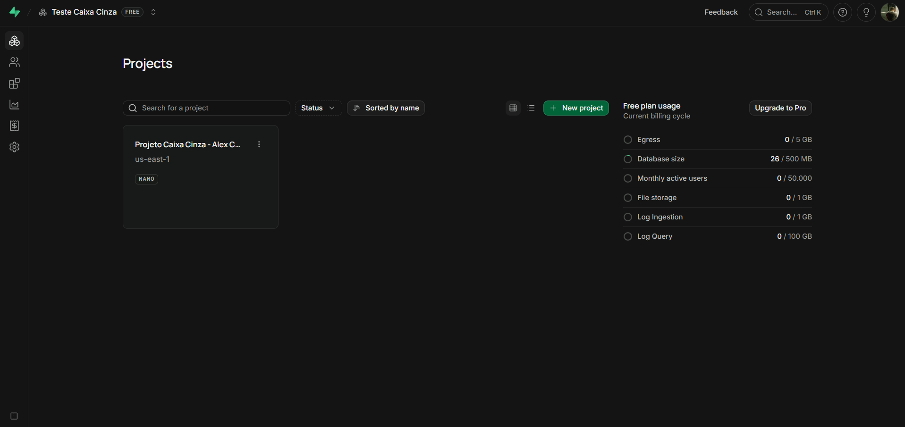

**Painel do Supabase**


**Autenticação habilitada**
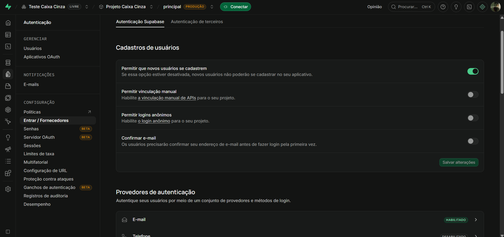

**Usuário criado**
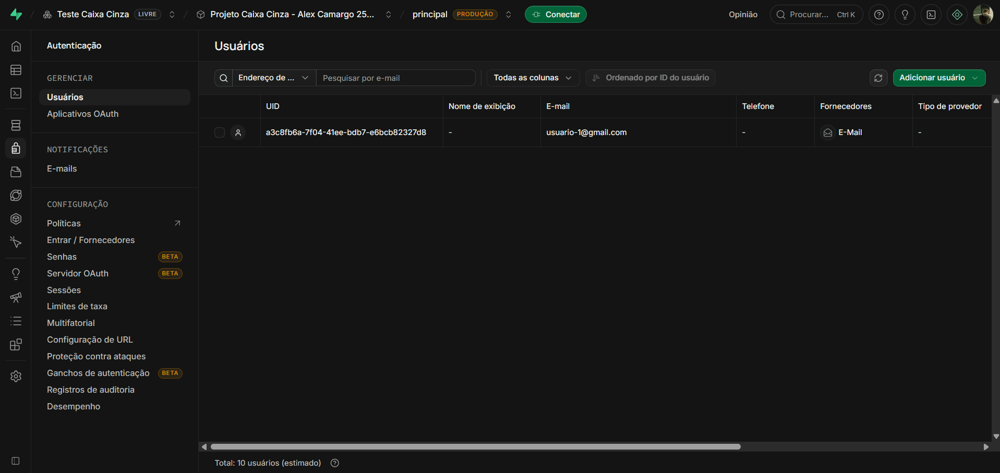

**Credenciais da API**
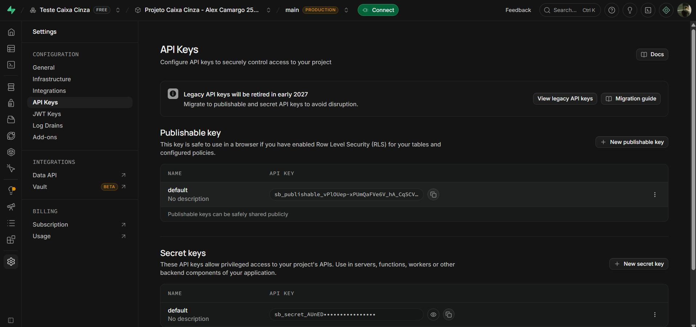

**Identificação do aluno no ambiente**
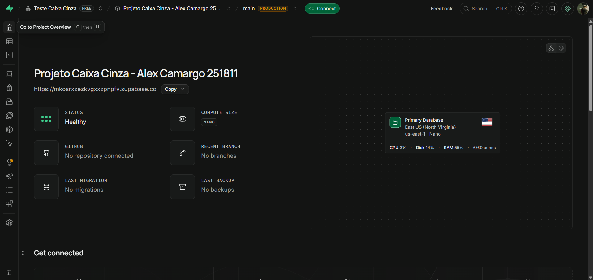

# Configuração do Postman

**Como o Workspace foi criado:** instalei o Postman Desktop e criei um workspace do tipo *Blank workspace*, chamado "Testes Caixa Cinza - Supabase". Escolhi o tipo *Internal*, para que as credenciais usadas nos testes não ficassem públicas.

**Como o Environment foi configurado:** dentro do workspace, criei o environment "Supabase Auth - Testes" com quatro variáveis: `base_url`, `api_key`, `email` e `password`. Em seguida, selecionei esse environment como ativo, no canto superior direito do Postman.

**Finalidade das variáveis:**

| Variável | Descrição |
|---|---|
| `base_url` | URL da API do Supabase (`https://[projeto].supabase.co`) |
| `api_key` | API KEY (publishable key) do projeto, enviada nos headers |
| `email` | E-mail do usuário de teste criado no Supabase |
| `password` | Senha do usuário de teste |

Com as variáveis, as requisições usam `{{base_url}}`, `{{api_key}}`, `{{email}}` e `{{password}}` em vez de valores fixos. Isso evita expor credenciais nas requisições, facilita a troca de ambiente e permite alterar os dados de teste em um único lugar.

**Como o Postman será utilizado nos testes:** para montar a requisição `POST` de login no endpoint de autenticação do Supabase, enviar os dados de cada cenário (válido e inválidos) e analisar status HTTP, corpo JSON, mensagens de erro e access token retornados.

**Evidências:**

**Workspace criado**
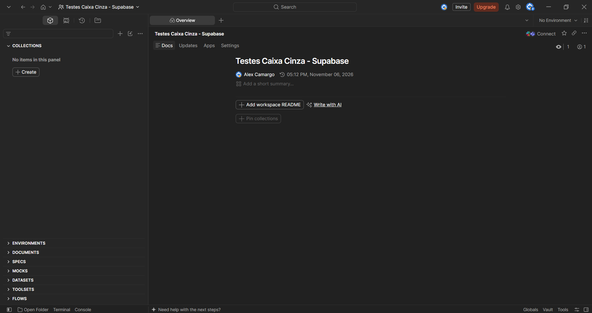

**Environment criado**
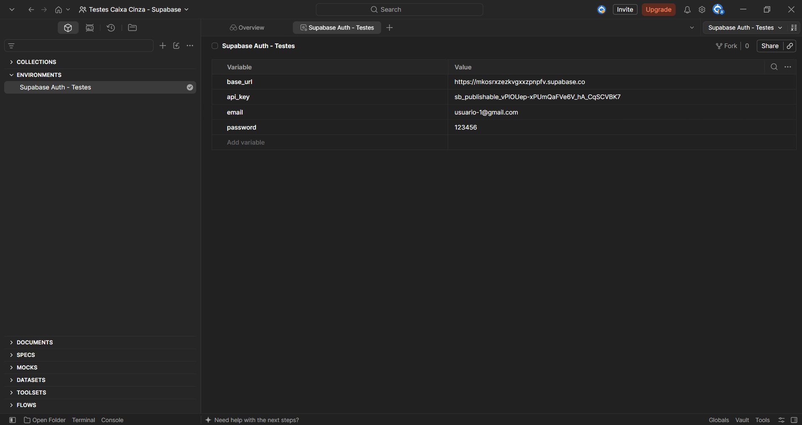

**Variáveis configuradas**
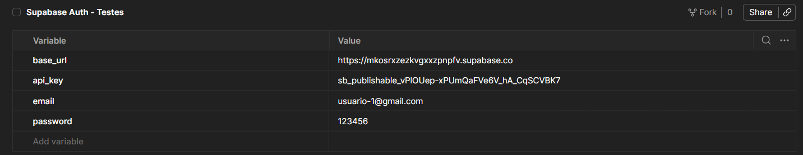

**Organização do Postman**
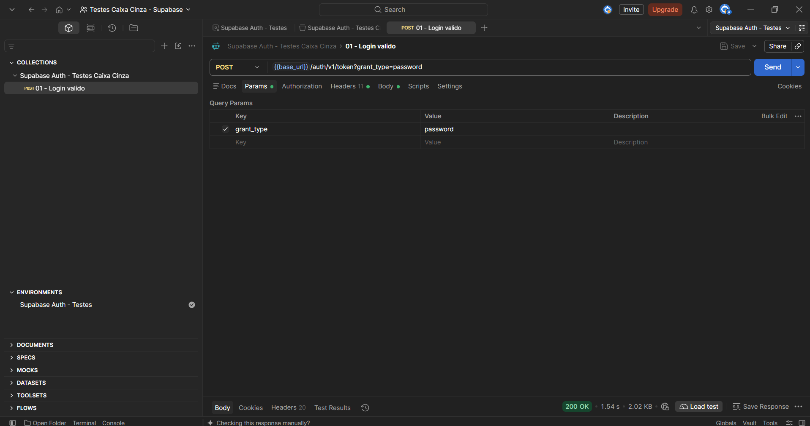

# Configuração das Requisições

**Endpoint utilizado:** `{{base_url}}/auth/v1/token?grant_type=password`

**Método HTTP utilizado:** `POST`

**Finalidade da requisição:** autenticar um usuário com e-mail e senha. Em caso de sucesso, a API do Supabase retorna o `access_token`, o `refresh_token` e os dados do usuário. Em caso de falha, retorna um status de erro e uma mensagem.

**Headers utilizados:**

| Header | Valor |
|---|---|
| `apikey` | `XXXXX` |
| `Authorization` | `Bearer XXXXX` |
| `Content-Type` | `application/json` |

**Body JSON utilizado:**

```json
{
  "email": "usuario@email.com",
  "password": "123456"
}
```

No Postman, o body usa as variáveis do environment: `"email": "{{email}}"` e `"password": "{{password}}"`.

**Evidências:**

**Endpoint configurado**
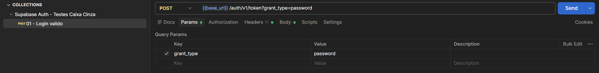

**Headers**
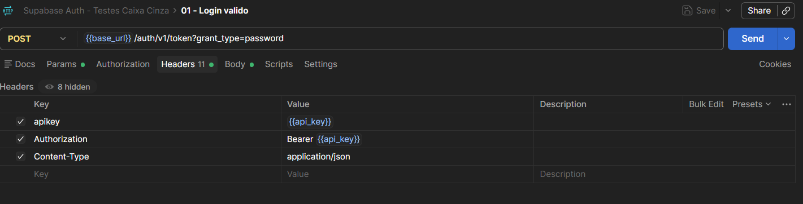

**Body JSON**
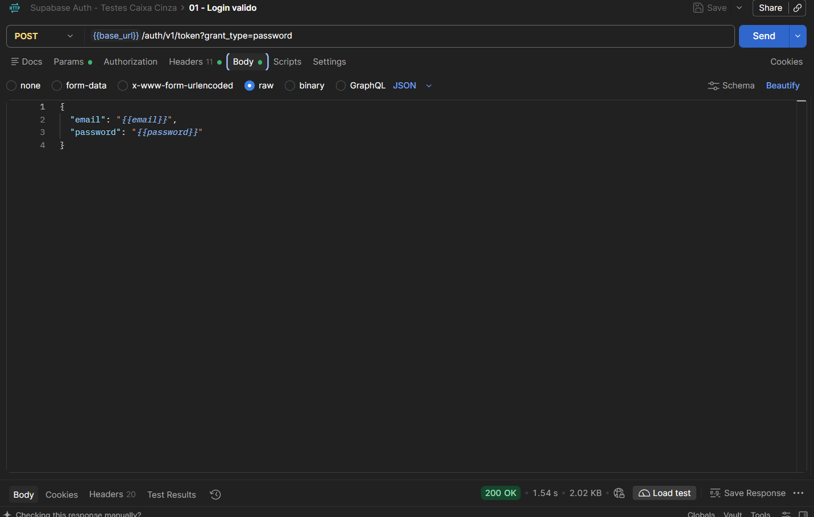

**Requisição criada no Postman**
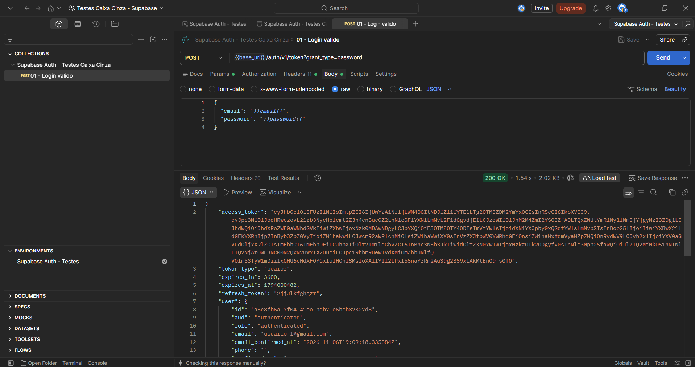

# Execução dos Testes

Os testes foram executados no Postman, com a requisição `POST {{base_url}}/auth/v1/token?grant_type=password`, variando apenas o body JSON. Em cada teste foram validados: status HTTP, corpo JSON da resposta, mensagem de erro, presença do `access_token` e comportamento da autenticação.

| Cenário | Entrada Utilizada | Resultado Esperado | Resultado Obtido | Status |
|---|---|---|---|---|
| Login válido | e-mail e senha corretos | Status 200 + access token | 200 OK, `access_token` retornado | OK |
| Senha incorreta | e-mail correto + `senha_errada_123` | Erro de autenticação | 400, `invalid_credentials` ("Invalid login credentials") | OK |
| Usuário inexistente | `emailerrado.23@exemplo.com` + senha do usuário de teste | Acesso negado | 400, `invalid_credentials` ("Invalid login credentials") | OK |
| Campos vazios | e-mail e senha vazios | Erro de validação | 400, `validation_failed` ("missing email or phone") | OK |
| Credenciais inválidas | `email-errado` + `456123` | Mensagem de erro | 400, `invalid_credentials` ("Invalid login credentials") | OK |

**Erros encontrados:** nenhum erro inesperado na API. Observou-se que ela devolve a mesma mensagem genérica ("Invalid login credentials") para senha incorreta, usuário inexistente e e-mail malformado, o que evita revelar quais e-mails estão cadastrados. Apenas o cenário de campos vazios retornou um erro de validação diferente (`validation_failed`).

**Evidências:**

**Teste válido**


**Senha incorreta**
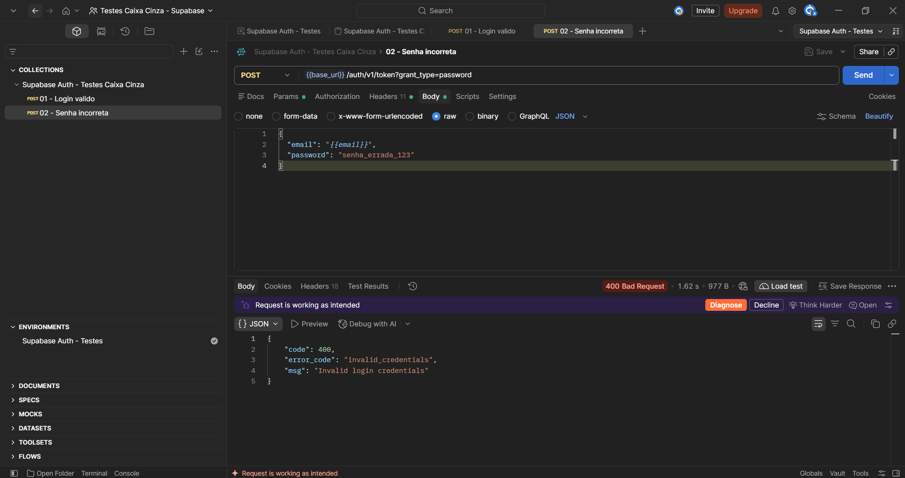

**Usuário inexistente**
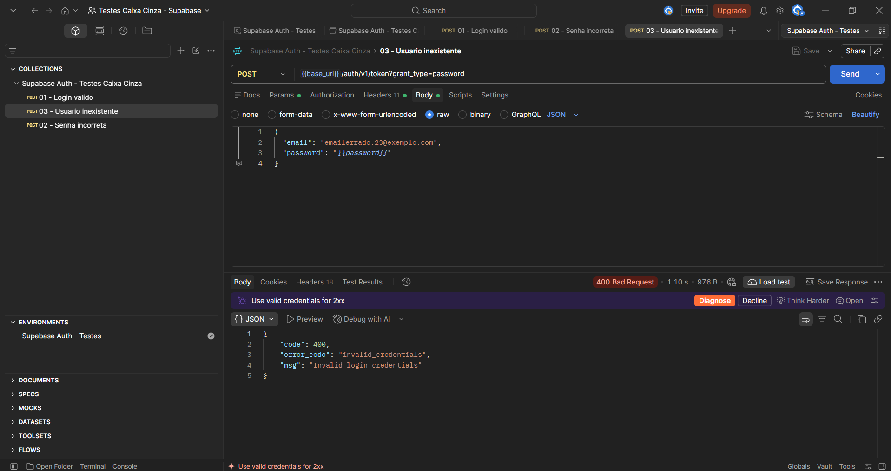

**Campos vazios**
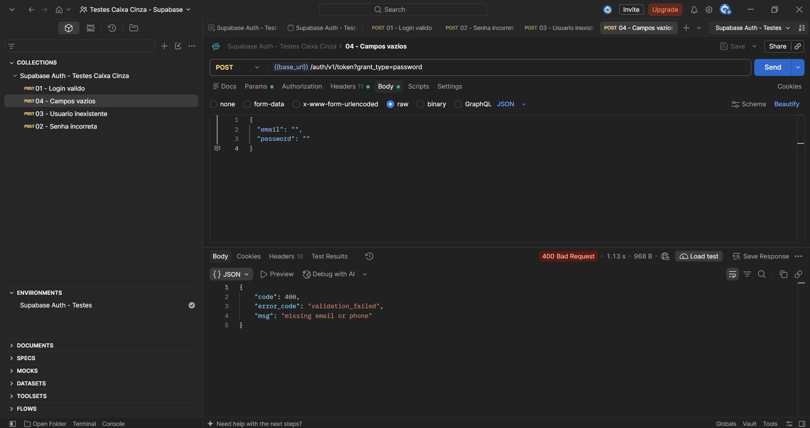

**Credenciais inválidas**
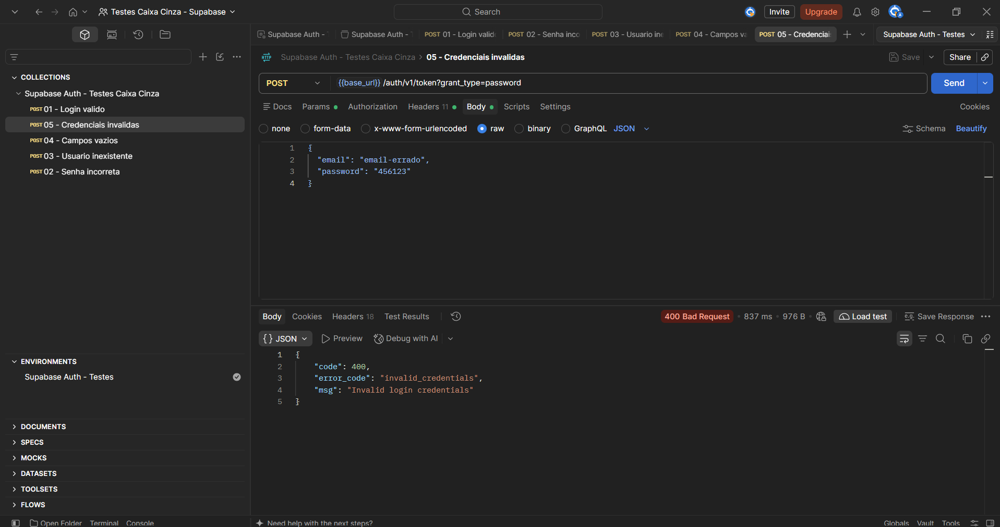

**Access token retornado**
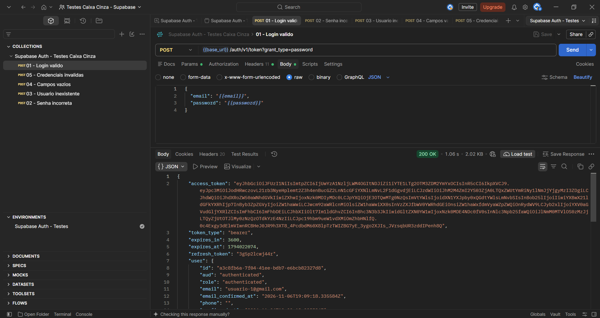

# Registro dos Testes

Os testes foram registrados na planilha [`planilha/registro_de_testes.xlsx`](planilha/registro_de_testes.xlsx), com os campos: ID do teste, Cenário, Entrada, Resultado esperado, Resultado obtido, Status (Sucesso/Falha) e Observações. Cada cenário foi registrado logo após a execução no Postman, com o status HTTP e a mensagem retornada pela API.

**Importância da documentação:** registrar os testes permite reproduzi-los, comparar o resultado esperado com o obtido, rastrear falhas e servir de base para testes futuros de regressão.

**Falhas identificadas:** nenhuma falha funcional. Os 5 cenários tiveram o comportamento esperado. Como ponto de atenção, o cenário de e-mail sem formato válido (CT-05) retornou a mesma mensagem genérica de credenciais inválidas, e não um erro específico de formato.

**Evidências:**

**Planilha preenchida**
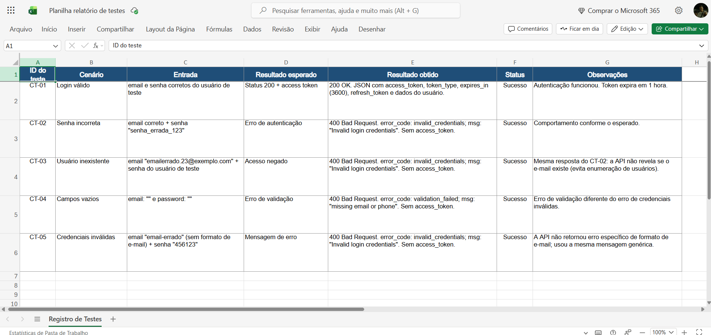

**Exemplos de registros**
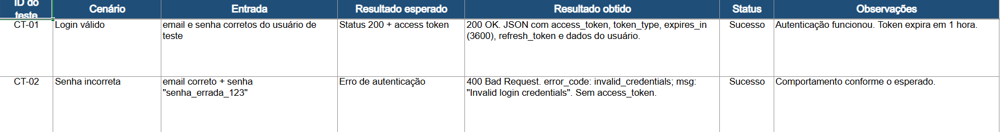

# Resultados Obtidos

- **Cenários executados:** 5
- **Cenários com resultado conforme o esperado:** 5
- **Cenários com divergência:** 0

| ID | Cenário | Status HTTP | Resposta |
|---|---|---|---|
| CT-01 | Login válido | 200 OK | `access_token`, `refresh_token` e dados do usuário |
| CT-02 | Senha incorreta | 400 Bad Request | `invalid_credentials` |
| CT-03 | Usuário inexistente | 400 Bad Request | `invalid_credentials` |
| CT-04 | Campos vazios | 400 Bad Request | `validation_failed` ("missing email or phone") |
| CT-05 | Credenciais inválidas | 400 Bad Request | `invalid_credentials` |

Nos cenários de erro, nenhuma resposta retornou `access_token`, ou seja, a API não concedeu acesso em nenhum caso inválido. Os cenários 2, 3 e 5 retornaram a mesma mensagem, e o cenário 4 retornou um erro de validação distinto, por faltarem os dados de entrada.

# Conclusão

- **Os testes foram executados corretamente?** Sim. Os 5 cenários obrigatórios foram executados no Postman, com as evidências registradas e documentadas na planilha.
- **A autenticação funcionou?** Sim. O login válido retornou 200 OK com o `access_token`, e todos os cenários inválidos foram recusados com erro 400 e sem token.
- **Dificuldades encontradas:** identificar a chave correta no painel do Supabase (publishable key) e usar a URL base sem o `/rest/v1/`; ajustar os nomes das variáveis do environment para `email` e `password`; e corrigir o body do teste de senha incorreta, em que a senha estava entre chaves duplas e era lida pelo Postman como uma variável inexistente.
- **Falhas identificadas:** nenhuma falha funcional. O único ponto de atenção é que um e-mail sem formato válido não gerou um erro específico de formato, e sim a mensagem genérica de credenciais inválidas.
- **Melhorias possíveis:** validar o formato do e-mail e retornar um erro específico; exigir uma política de senha mais forte (o mínimo padrão é de 6 caracteres); limitar tentativas de login para reduzir ataques de força bruta; habilitar autenticação multifator; ampliar os testes (token expirado, refresh token, e-mail não confirmado); e automatizar a coleção do Postman com Newman em um pipeline de CI.
- **Importância dos testes caixa cinza em APIs:** combinam o conhecimento do contrato da API (endpoint, headers, body) com a análise das respostas, permitindo detectar falhas de validação e de segurança sem acesso ao código-fonte, com custo menor que testes de caixa branca.
